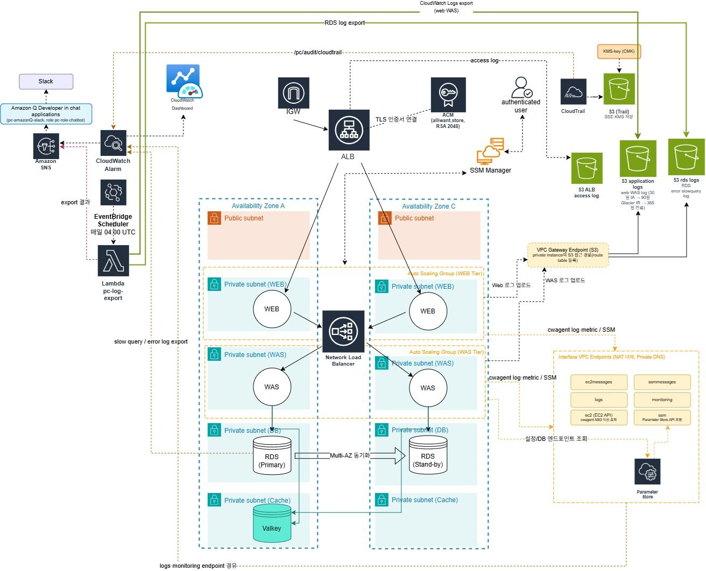
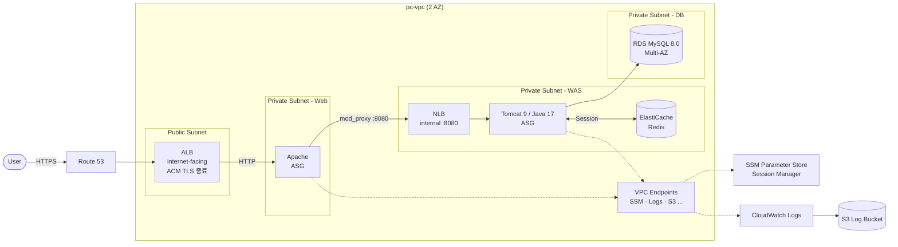

# AWS 3-Tier PetClinic Infrastructure

> Spring PetClinic을 **동물병원 예약 서비스**로 가정하고, AWS 위에 고가용성·보안·관측성을 갖춘 3-Tier 인프라를 설계·구축한 팀 프로젝트입니다.
> Bespin Global 클라우드 엔지니어 양성 과정 (KDT) 최종 프로젝트 · 4인 팀

<!-- TODO: 전체 아키텍처 이미지 추가 -> docs/images/architecture.png -->
<!--  -->

## 한눈에 보기

| 항목 | 내용 |
|---|---|
| 서비스 시나리오 | 동물병원 예약 서비스 (평시 동시 사용자 50~100명) |
| 애플리케이션 | [Spring Framework PetClinic (팀 포크)](https://github.com/TEAM-24-7/petclinic_btc) — WAR, Tomcat 9 |
| 구성 | 2 AZ × 4 Tier (Public / Web / WAS / DB), 서브넷 8개 |
| 진입점 | Route 53 → ALB (HTTPS, ACM) → Apache → 내부 NLB → Tomcat → RDS MySQL |
| 접근 방식 | Bastion 없이 **SSM Session Manager** |
| 외부 통신 | NAT Gateway 대신 **VPC Endpoint** |
| 세션 | **ElastiCache Redis** 세션 공유 (애플리케이션 코드 수정 없이 WAS 설정만으로) |
| 로그 | Apache/Tomcat/ALB/CloudTrail 로그 → CloudWatch → **S3** |
| 목표 | **RTO 3시간 / RPO 10분** |

## 아키텍처



## 핵심 설계 결정

| 결정 | 선택 | 이유 |
|---|---|---|
| 인스턴스 접근 | SSM Session Manager | SSH 포트·Bastion 제거, IAM 기반 접근 제어와 세션 감사 |
| LB 구성 | Web: 외부 ALB / WAS: 내부 NLB | L7 라우팅·TLS 종료는 ALB, 내부 구간은 단순 TCP 분산 |
| Web→WAS 연결 | Apache `mod_proxy` (HTTP) | mod_jk(AJP)는 단일 WAS 직결 구조라 NLB 경유 확장에 불리 |
| 설정 주입 | SSM Parameter Store + User Data | 골든 AMI에 엔드포인트/비밀번호를 굽지 않음 → 환경 간 재사용 |
| 골든 AMI | 실행에 필요한 것만 포함 | git/Maven/mysql-client 제외, WAR는 별도 빌드 EC2에서 생성 |
| 외부 통신 | VPC Endpoint | NAT 비용 절감, 트래픽이 AWS 내부망으로만 흐름 |
| 세션 | Redis (Redisson Tomcat Session Manager) | ASG 스케일 인/아웃 시에도 로그인 세션 유지, 앱 코드 무수정 |
| DB | RDS MySQL Multi-AZ + Automated Backup | 장애 시 자동 Failover, RPO 목표 충족 |

자세한 근거: [docs/decisions.md](docs/decisions.md)

## 문서

| # | 문서 | 내용 |
|---|---|---|
| 1 | [네트워크](docs/01-network.md) | VPC, 서브넷, 라우팅, 보안그룹 체인, VPC Endpoint |
| 2 | [골든 AMI](docs/02-golden-ami.md) | Web/WAS 이미지 빌드, EBS 마운트 |
| 3 | [로드밸런서 & Auto Scaling](docs/03-load-balancing-asg.md) | ALB/NLB, Launch Template, ASG |
| 4 | [설정 관리 (SSM)](docs/04-ssm-parameter-store.md) | Parameter Store 구조, IAM Role |
| 5 | [데이터베이스 & 세션](docs/05-rds-redis.md) | RDS 사이징 근거, Redis 세션 |
| 6 | [DNS & TLS](docs/06-dns-tls.md) | 가비아 → Route 53 위임, ACM |
| 7 | [로그 파이프라인](docs/07-logging.md) | CloudWatch Agent, S3 적재 |
| 8 | [백업 & DR](docs/08-backup-dr.md) | RTO/RPO, 장애 시나리오 |
| 9 | [부하 테스트](docs/09-load-test.md) | k6 시나리오, CloudWatch 대시보드 |
| - | [트러블슈팅](docs/troubleshooting.md) | 구축 중 겪은 문제와 해결 |

## 레포 구조

```
.
├── README.md
├── docs/                    # 단계별 구축 문서, 설계 결정, 트러블슈팅
├── scripts/
│   ├── golden-ami/          # 골든 AMI 빌드 스크립트 (web / was)
│   ├── user-data/           # Launch Template User Data (web / was)
│   └── ssm/                 # Parameter Store 등록 스크립트
├── configs/
│   ├── apache/              # mod_proxy 가상호스트
│   ├── tomcat/              # setenv.sh, Redisson 세션 설정
│   └── cloudwatch/          # CloudWatch Agent 설정
└── load-test/               # k6 스크립트
```

## 기술 스택

`AWS VPC` `EC2` `Auto Scaling` `ALB` `NLB` `RDS (MySQL 8.0)` `ElastiCache (Redis)` `Route 53` `ACM` `SSM` `CloudWatch` `CloudTrail` `S3` `Apache HTTP Server` `Tomcat 9` `Java 17` `k6`

## 팀

| 이름 | 역할 | GitHub |
|---|---|---|
| 대석 | <!-- TODO: 담당 역할 --> | <!-- TODO --> |
| <!-- TODO --> | | |
| <!-- TODO --> | | |
| <!-- TODO --> | | |

## 회고

<!-- TODO: 배운 점, 아쉬운 점 3~5줄. 예) v1/v2 병행 중 수동 변경으로 설정 드리프트를 겪고 전체 재구축 → IaC(Terraform) 필요성 체감 -->
